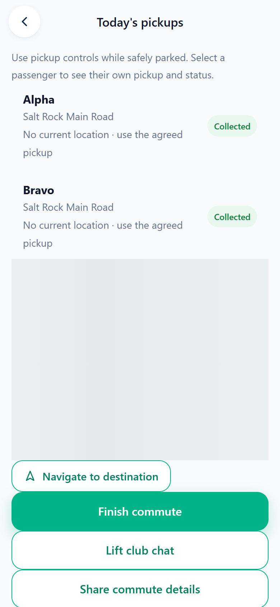
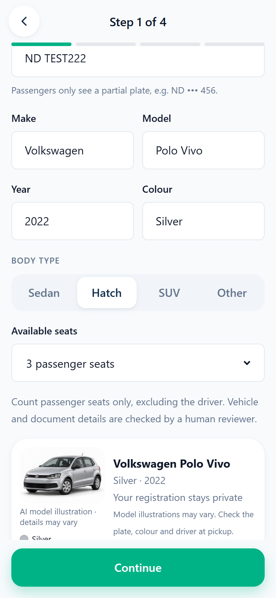

# Driver pilot review — 18 October 2026

Branch: `codex/driver-reliable-pilot`. Review locally before any merge to main. No hosted database migration, provider change, paid preview backend or production deployment is part of this review.

This onboarding review records build `5d1fce2`. The [notification follow-up](driver-notification-review.md) has separate verification evidence; the running preview remains on this build while the user tests it.

## Implemented

- Driver setup is visible from Home and Profile. Four steps cover the driver's real name, make/model/year/colour/body style and seats; mapped home/work commute, travel days/times, pickup style and 0–30 minute detour; four verification documents; then photos, summary and contribution. Continue explicitly saves new-driver drafts before navigating.
- Pickup style is validated and saved per leg: doorstep origins, named meeting points, or either. Both matching paths respect that choice and passenger walking limits. Changed preferences invalidate old quotes and pending acceptances while preserving existing agreed pickups.
- Vehicle publication uses a narrow authenticated server function, fixing first-time setup's PostgREST upsert permission error without opening ownership or approval columns. Name changes invalidate approved identity evidence through every permitted write path. Return-off pauses new evening requests while accepted trips continue, and restored settings consistently use the morning leg.
- Mobile form grids fit 320px and 390px screens. The generic model-substitution photo is removed. A labelled AI example is scoped to the silver 2022 Volkswagen Polo Vivo hatchback; other vehicles use their uploaded photo or an honest unavailable state. Optional generation is implemented but remains disabled until a provider and reviewed source catalogue are configured; see [illustration behavior and asset prompt](vehicle-illustrations.md).
- Server-backed onboarding drafts restore the setup step, vehicle, actual mapped commute and owned car photo. Upload progress, rejection reasons and expiry information come from the account snapshot, never from a draft approval flag.
- New licence/insurance uploads require an expiry date before review. All four latest documents require human approval; an ID approval alone does not produce the full driver badge. Existing approved documents without recorded expiry remain explicitly identifiable as legacy records.
- Expired, replaced or rejected approvals hold new pickups and notify affected clubs. Agreements and history remain saved. A driver can safely finish a held journey for passengers already collected; unresolved pickups are recorded as absence rather than no-show. Recovery is notified after human reapproval.
- Request inboxes refresh through authorised Realtime events, foreground/reconnect catch-up and bounded polling. Withdrawn requests retain their own status. Decisions keep exact request/leg identity and meaningful server errors.
- Morning/evening controls use stable route IDs and consistent sorting. Pausing new requests persists and can be reopened after reload; existing agreements continue. Dashboard contributions use agreed membership amounts rather than new advertised prices.
- Each rider has separate arrival, collection, no-show, pending and error state. An in-flight action cannot switch to another passenger. External navigation targets the selected pickup. Sharing labels accurately describe shared details.
- Group chat uses stable message UUIDs, visible retry state, per-club ordered message sequences, read cursors, history pagination and reconnect catch-up. Durable message notifications exclude the sender and hide message bodies from lock-screen previews.
- Acceptance reconciles the changed leg instead of every club while holding a seat lock. A conservative sum of overlapping pickup detours prevents exceeding the driver's limit; this is not a road-optimised multi-stop itinerary.
- Private drafts/read cursors are included in export and cascade with account deletion. New hold state is private and follows the existing test-data and notification-delivery boundaries.

## Validation

| Check | Result |
|---|---|
| TypeScript, ESLint, production build | Passed; existing bundle-size warning remains |
| Unit checks | 257 passed across 22 files |
| Full browser regression | 54 passed in 1.7 minutes; mocked backend and synthetic GPS where applicable |
| Real local fresh-driver onboarding | Passed in 49.5 seconds, 2 minutes including build; local OTP, mapped commute, four private uploads, saved settings on both legs, pending approval, draft cleanup and reload |
| Real local driver/two-passenger browser journey | Prior 17 October validation passed in 4.8 minutes, 5.8 minutes including build |
| Original database / fixture isolation / lifecycle / safety | 59 / 25 / 31 / 23 passed, rolled back |
| New driver / approval-hold database checks | 79 / 36 passed, rolled back |
| Real two-client message concurrency | 13 assertions passed; generated accounts removed |
| Final-seat race | Exactly one acceptance, one active membership, zero open seats |
| Pickup / vehicle publication / illustration database checks | 46 / 42 / 45 passed; illustration race produced one claim across six connections |
| Fresh database replay | All 24 migrations, seed and eight suites: 327 assertions passed on disposable port 58322; schema/security matched local port 57322 |
| Source credential scan | Passed; ignored environment files excluded |

The real browser journey uses fixed local OTP and actual road quotes, manual acceptance, group messages, pause/reopen after reload, two independent pickup transitions and completed server records. It does not mock business API responses. Its map styles are deliberately unavailable to exercise manual coordinate entry; it does not prove physical GPS or provider delivery.

An initial integrated run exposed route-order-dependent settings selection and a two-member cleanup capacity violation. Both were fixed and the journey reran successfully. One full browser run then encountered a sign-in document-load timeout; waiting for DOM readiness while retaining all authentication assertions fixed that harness dependency, and the complete 50-test rerun passed.

## Local review

Start the existing sandbox and gateway, then run `npm run preview:driver`. This builds the normal app with the fixed local backend and serves http://127.0.0.1:5180/signin.

Choose **Sign in**, use local test driver **0820000101**, and enter local code **123456**. These identities and codes exist only in the isolated sandbox and send no SMS. The app has no demo sign-in bypass. Drivers/fixtures stay labelled as test data.

That seeded driver is already onboarded. To review **first-time onboarding**, open http://127.0.0.1:5180/role in a separate private browser window, choose **Driver**, create an account using reserved local number **0820000002**, and enter code **123456**. Enter your test name and vehicle details, then select mapped home/work locations and pickup preferences. Only test uploads belong in this sandbox. Use **Volkswagen → Polo Vivo → 2022 → Silver → Hatch** to see the scoped illustrative example. The automated fresh-driver test removes only the synthetic account/files it creates, leaving this number unused for your review.

The existing driver can open **Driver setup** from Home or Profile to review/edit its setup. Turning off the evening offer closes new requests; it does not cancel accepted passengers' trips. A full setup save still publishes vehicle and legs in sequence; any failure is surfaced for retry rather than reported as a success.

`npm run preview:driver:prepare` prepares two fake passengers through normal local OTP, road matching and request APIs. It leaves their requests pending for the manual driver to review. It preserves existing pending/accepted requests rather than resetting them. Passenger sign-ins are **0820000001** and **0820000003**, with the same local-only code **123456**. Use separate browser profiles for simultaneous roles.

Review Home, My Route, Requests, Messages, Verification documents, Settings, Contributions and History. An empty request inbox is a valid persisted state; the test passenger can submit a compatible request from another browser session. See [local setup](local-e2e.md) for the Salt Rock Main Road → Umhlanga Ridge example and guarded trip controls.

Tests use reserved local passenger numbers and clean them transactionally; do not run the browser lifecycle suite while manually reviewing those same accounts. Keep the gateway and preview processes running while using the local link.

## Remaining release gates

- Physical Android locked-screen GPS and closed-app FCM receipt require device/provider proof. Browser and synthetic-GPS tests do not establish these.
- Real SMS delivery remains distinct from fixed-code local Auth testing.
- Automatic illustrations for arbitrary vehicles require the server provider, usage activation and exact reviewed references. Only the single explicitly labelled preview asset is available without that setup; no paid provider request was made.
- A human reviewer must check driver documents and operate the safety process. The UI does not establish insurance or transport-law clearance.
- The hosted project must be reconciled before applying migrations. These changes have been applied only to isolated local databases.
- The existing large Mapbox/application bundle warning remains; the build succeeds. Full road-based multi-stop optimisation is not included; the current detour guard is conservative.
- Main remains unchanged pending the user's preview review and outstanding release checks.
